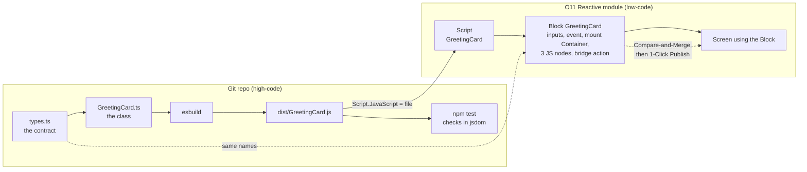

# Building a custom TypeScript pattern for OutSystems 11, step by step

The O11 version of [the ODC guide](Components_ODC.md). Same idea, same reference implementation in [`greeting-card/`](greeting-card/), same contract and tests. What changes is the platform side: instead of the remote OutSystems MCP server and Mentor, the agent works through **Service Studio's own MCP server**, editing the module you have open with the OutSystems Model API, and you review every change in Service Studio's Compare-and-Merge window before it lands.

> **Status: not yet run end to end on O11.** Steps 1 to 5 are the same code and the same tests that were run on ODC. Steps 6 to 8 are written from the Service Studio MCP's documented and verified behaviour, but this exact Block has not been built and published on O11 yet. Where an ODC finding may not carry over, the step says so. Replace this note with your measurements once you've run it.

## The idea

Unchanged from ODC: don't make Web Components work natively. Use the **Block as a thin bridge**: it receives data through Input Parameters, raises Events, and in its lifecycle handlers it creates and drives an instance of a class that lives in a JavaScript bundle built outside the platform. The component evolves in Git with types, a build and tests; the Block stays small.

The technique comes from [*AI-Powered Frontend Development in OutSystems O11 and ODC*](https://antonio-carvalho.medium.com/ai-powered-frontend-development-in-outsystems-o11-and-odc-4d408fdb4ade) by **António Carvalho**, which covers both platforms.

**Reactive Web only.** The bridge relies on Block lifecycle events (`OnReady`, `OnParametersChanged`, `OnDestroy`) and JavaScript nodes with `$parameters` / `$actions`. Those exist in Reactive Web and Mobile modules. Traditional Web Blocks don't have that lifecycle, so this recipe doesn't apply to them.

## What's different from ODC

| | ODC | O11 |
|---|---|---|
| Agent's channel | Remote OutSystems MCP server, Mentor edits the app | Service Studio MCP on your machine, the agent edits the open module with C# Model API code |
| What it can reach | Every app in the tenant | Only modules open in Service Studio, plus their references |
| Quota | Mentor turns, counted per tenant | None. Edits run locally |
| Reviewing a change | Read the run's events | Service Studio's **Compare-and-Merge** window, before anything is merged |
| Script content | Pasted into a Mentor prompt, and an AI model copies it (risk of "improvements") | Assigned directly to the Script's `JavaScript` property. No model rewrites it |
| Publishing | A Mentor turn | 1-Click Publish, through the MCP tool or by you in Service Studio |
| Confirming the live version | `env_app` revision check | Service Center module version, or the `moduleinfo` manifest |
| Deploying to other environments | Deployment tools in the same MCP | LifeTime, by hand. Not covered here |
| Adding a module dependency | Mentor does it | **You do it** in Manage Dependencies. The agent can't add a new dependency |

## What you end up with



- A **Script** in the module holding your bundle, unchanged.
- A **Block** with Input Parameters, an Event, an empty mount Container and three JS nodes.
- A **screen** using the Block, to test it and audit the published JavaScript.
- A repo where the component is ordinary TypeScript.

### Where to put it

| Module | Use it when | Notes |
|---|---|---|
| A **Reactive library** (e.g. a `*_Pat` module) | The pattern will be reused | Libraries have no screens, so the harness screen lives in a consuming app. Set the Block to **Public** |
| A **Reactive Web app** | First experiment | Script, Block and harness in one module, one publish |

Start in a throwaway Reactive app. Move to the library once the steps work.

## Prerequisites

| What | Why | Notes |
|---|---|---|
| An O11 environment you can publish to | The target | A personal or development environment. Never production |
| Service Studio 11 with the **MCP Server** enabled | The agent's channel | Approve the agent's session when Service Studio asks. To let the agent merge and publish without a dialog, allow **automatic merge and publish** in the MCP Server dialog; otherwise you'll do those two steps yourself |
| The module open in Service Studio | The agent only sees open modules | Open the consuming app too, if the harness lives there |
| Node.js LTS | Build and tests | Same as ODC |
| Claude Code | Drives the Model API edits | No OutSystems plugin or tenant sign-in needed for O11 |
| `curl` and `diff` | Verifying the published files | Git Bash has both |

## The golden rule: BEM class names

Same rule as [Rule 0 in the ODC guide](Components_ODC.md#rules-for-every-custom-pattern), and it applies to every pattern on both platforms: **every CSS class the pattern owns follows BEM, with the pattern class as the block.**

| BEM part | Form | GreetingCard | Who sets it |
|---|---|---|---|
| Block | `<pattern>` | `greeting-card` | The Block's main container, through its Style Classes |
| Element | `<pattern>__<element>` | `greeting-card__body`, `__text`, `__title`, `__count`, `__button` | The TypeScript class |
| Modifier | `<pattern>--<modifier>` or `<pattern>__<element>--<modifier>` | `greeting-card--compact` | A screen, through `ExtendedClass` |

The full rule and every other CSS rule for patterns (OutSystems UI variables with base-theme fallbacks, one-class selectors, device classes, right-to-left, accessibility) are in **[Style.md](Style.md)**. `npm test` enforces the parts a script can check, so they hold the same way on O11 as on ODC.

Two O11 notes:

- **Check the fallback values against your OutSystems UI version.** Style.md lists the values from OutSystems UI 2.30.0 on ODC. An O11 environment may run an older version; read its `OutSystemsUI.css` `:root` from your app's `moduleinfo` and adjust `OSUI_TOKENS` in the tests if they differ.
- **In Service Studio, never style a pattern from a screen** through its OutSystems UI classes (`.card`, `.btn`) or by element (`.greeting-card p`). Pick a modifier through `ExtendedClass` instead.

## Steps 1 to 5: identical to ODC

Nothing in the repo depends on the platform. Follow the ODC guide for these:

1. [Start from the reference layout](Components_ODC.md#step-1-start-from-the-reference-layout): copy `greeting-card/`, rename namespace, class, output file and the BEM block.
2. [Write the contract first](Components_ODC.md#step-2-write-the-contract-first), including all three [rules for every custom pattern](Components_ODC.md#rules-for-every-custom-pattern): BEM class names (the golden rule above), the `ExtendedClass` Input Parameter, and the main container's Style Classes expression. The expression is valid O11 syntax as written:
   ```
   "greeting-card" + If(ExtendedClass <> NullTextIdentifier(), " " + ExtendedClass, "")
   ```
3. [Write the class to the bridge's rules](Components_ODC.md#step-3-write-the-class-to-the-bridges-rules): constructor, `onParametersChanged`, `destroy`.
4. [Build for diffability](Components_ODC.md#step-4-build-for-diffability-not-size): `iife`, `es2019`, not minified, `dist/` committed, `eol=lf`.
5. [Prove it locally](Components_ODC.md#step-5-prove-it-locally-before-spending-agent-quota): `npm test` until green.

Two notes for O11:

- **Inject the stylesheet from the class, as `styles.ts` already does.** Edits to a non-empty Block stylesheet don't publish reliably through the MCP (the merge succeeds, but the old CSS is still served). Layout CSS shipped inside the bundle avoids the problem. If you need app-wide CSS, put it in the theme stylesheet, which publishes reliably.
- **Check that the OutSystems UI classes you reuse exist in your version.** The card uses `card` and `btn btn-primary`; both are in OutSystems UI 2.x. Older O11 environments may be on an earlier OutSystems UI.

## Step 6: the platform side, reviewed in Service Studio

With O11 you aren't spending a quota, but **one element per request** is still the right size: each one ends in a Compare-and-Merge window you can actually read. Ask for these three in order, in the same Claude Code session. Every request ends the same way:

1. the agent edits a copy of the module with Model API code
2. it reads the result back and checks for TrueChange errors
3. it calls merge, and Service Studio shows the diff
4. you accept the diff in Service Studio

If your Service Studio is set to accept merges automatically, step 4 happens without a dialog. Look at the module afterwards anyway.

### Request A: the Script

The agent reads `dist/GreetingCard.js` and assigns it to the Script's `JavaScript` property. The content goes in as a C# string literal, not through a model's rewrite. The main risk is in escaping, so the request asks for a check:

```text
In module <Module>, add a Script named "GreetingCard" whose JavaScript is the exact
contents of greeting-card/dist/GreetingCard.js. Set the property directly from the
file; don't reformat anything. After applying, read the Script back and confirm its
length and line count match the file. Create nothing else. Merge, don't publish.
```

If the module is a library and consumers should load the Script through the Block only, leave it **not** Public. The Block's Required Scripts takes care of loading it.

### Request B: the Block

Same content as ODC, Turn B. Copy the names from `types.ts`. The **bridge Client Action** still matters on O11: in a Reactive JavaScript node, `$actions` lists Client Actions, not Block Events, so the event is raised through a Client Action passed into the class. Keep the `if ($parameters.Instance)` guards too, for the same lifecycle reason.

```text
In module <Module>, create a Block "GreetingCard" (Public = <Yes for a library, No
for an app>). It is a thin bridge to window.ClaudeTest.GreetingCard defined in the
"GreetingCard" Script. Only create this Block. Merge, don't publish.

1. Input Parameters: Name (Text, mandatory, default ""), ButtonLabel (Text, not
   mandatory, default "Greet"), ExtendedClass (Text, NOT mandatory, default "").
2. Event: OnGreetClicked with one input parameter Count (Integer).
3. Local Variable: Instance (Object).
4. Widget tree: a single empty Container named "MountPoint" (the pattern's main
   container). Set its Style Classes to exactly:
   "greeting-card" + If(ExtendedClass <> NullTextIdentifier(), " " + ExtendedClass, "")
5. Required Scripts: add the "GreetingCard" Script.
6. Client Action "TriggerGreetClicked" (input Count, Integer) whose only step is
   Trigger Event OnGreetClicked with Count = Count.
7. Handlers for OnReady, OnParametersChanged and OnDestroy, each with one
   JavaScript node, exactly as below.

OnReady — inputs RuntimeId = MountPoint.Id, Name, ButtonLabel; output Instance,
assigned to the local variable Instance:
$parameters.Instance = new ClaudeTest.GreetingCard({
  runtimeId: $parameters.RuntimeId,
  name: $parameters.Name,
  buttonLabel: $parameters.ButtonLabel,
  events: { OnGreetClicked: $actions.TriggerGreetClicked }
});

OnParametersChanged — inputs Instance, Name, ButtonLabel:
if ($parameters.Instance) {
  $parameters.Instance.onParametersChanged({
    name: $parameters.Name,
    buttonLabel: $parameters.ButtonLabel
  });
}

OnDestroy — input Instance:
if ($parameters.Instance) {
  $parameters.Instance.destroy();
}

ExtendedClass is used only by MountPoint's Style Classes. Do not pass it to any
JavaScript node. Lay out each handler's flow cleanly (Start, JS node, Assign
where needed, End) before merging.
```

In the Compare-and-Merge window, check the four things the ODC guide checks after publishing: the guards are there, the names match `types.ts`, `ExtendedClass` reaches no JS node, and the event goes through `TriggerGreetClicked`.

### Request C: a screen that uses it

A Block that no screen uses isn't in the published JavaScript, so build a harness. In an app, put it on any screen. For a library, open a consuming Reactive app, **add the dependency on the Block yourself** in Manage Dependencies (the agent can't add new dependencies), then ask:

```text
In module <ConsumerApp>, on the <Screen> screen, below the existing content, add a
test harness for the GreetingCard Block. Change nothing else. Merge, don't publish.

1. Screen Local Variable VisitorName (Text, default "OutSystems").
2. A Label "Your name" and an Input bound to VisitorName.
3. A GreetingCard Block with Name = VisitorName and ButtonLabel = "Say hello".
4. Handle OnGreetClicked with a screen Client Action "GreetingCardOnGreetClicked"
   (input Count, Integer) whose only step is a Message:
   "OnGreetClicked fired: Count = " + Count.
```

If colleagues should open the harness without logging in, ask for the **Anonymous role** to be added to the screen's roles. Setting the screen's anonymous-access flag directly gets dropped by the merge.

## Step 7: publish

Publish the module that changed, and with a library, then the consumer:

1. **The library** (if you used one). Then, in the consumer, **refresh the dependency** (the agent can do this) so it picks up the new Block.
2. **The consumer app**, or the single app.

Ask for it explicitly ("publish <Module>"). The agent only publishes when asked. It uses 1-Click Publish and waits; a small module took about 16 seconds when the MCP was tested. If automatic merge and publish isn't allowed in the MCP Server dialog, the call is blocked and nothing is published; publish from Service Studio instead.

A "published" result isn't proof on its own. Confirm in **Service Center → Factory → Modules → <Module>** that the current version is the one you just published, and run step 8.

## Step 8: verify what was actually published

### 8a. The Script is your bundle

O11 Reactive modules list their versioned files at `https://<server>/<App>/moduleservices/moduleinfo`. Find your Script in that manifest by name rather than guessing the path, since the naming differs from ODC's `UserScripts` and a library's Script is served through the consuming app:

```bash
APP=https://<server>/<App>
curl -s "$APP/moduleservices/moduleinfo" | grep -o '[^"]*GreetingCard[^"]*\.js[^"]*'
curl -s -o published.js "https://<server>/<App>/<that path>"

# strip a BOM if there is one, then compare
sed '1s/^\xEF\xBB\xBF//' published.js | diff dist/GreetingCard.js - && echo IDENTICAL
```

On ODC the platform added a BOM and dropped the final newline; the code itself was identical. **Measure it on O11** and record the table here, as the ODC guide does. Because the Script was set from the file rather than retyped by a model, any difference you find comes from the platform or from escaping, not from AI rewriting.

### 8b. The JS nodes are wired as you asked

Download the app's script chunks from the same manifest and search for the class. The Block's compiled code is in a file named like `scripts/<Module>.<Flow>.GreetingCard.mvc.js`:

```bash
grep -l "ClaudeTest.GreetingCard" *.js
```

Check the same four things as on ODC: the guards survived (possibly rewritten as `x && …`), the parameter names match `types.ts`, no `extendedClass` reaches the JS nodes, and the event goes through `TriggerGreetClicked`. Also look for `MountPoint`'s style expression, recalculated from `ExtendedClass`.

### 8c. It works in a real browser

Same click-through as [ODC step 8c](Components_ODC.md#8c-it-works-in-a-real-browser): the card renders, each click shows the Message with an increasing count, typing updates the greeting live, the main container carries `greeting-card` plus any `ExtendedClass`, every class inside it is `greeting-card__*`, `greeting-card--*` or OutSystems UI, and the console is clean.

## Limits to know before you start

These are documented limits of the Service Studio MCP, not ones we hit on this pattern yet.

| Limit | What to do |
|---|---|
| The agent can only edit modules **open** in Service Studio | Open the library and the consumer before asking |
| The agent **can't add a new dependency** | Add it in Manage Dependencies yourself, then ask the agent to continue |
| Refreshing references drops any unmerged edits from the agent's view | Merge first, then refresh |
| **Block stylesheet** edits may not reach the published CSS | Ship layout CSS in the bundle; use the theme for app-wide CSS |
| Publishing is blocked unless you allow automatic merge and publish | Allow it in the MCP Server dialog, or publish from Service Studio |
| A screen's anonymous-access flag is dropped by the merge | Add the Anonymous role to the screen's roles |
| The write tools are a **Beta Feature** | See the [Beta Features agreement](https://www.outsystems.com/legal/beta-features-agreement) |
| No deployment between environments | Use LifeTime |

## Making it yours

1. Copy `greeting-card/`, rename namespace, class, output file and the BEM block.
2. Write `types.ts`, including `ExtendedClass` (Text, not mandatory, default `""`), applied by the main container, and the modifiers it accepts.
3. Write the class to the three-member rules, with every class BEM under the pattern block (the golden rule); `npm test` until green.
4. Commit, including `dist/`.
5. Open the module (and the consumer) in Service Studio.
6. Request A (Script from file), request B (Block with bridge action and the main container's Style Classes), request C (harness). Review each Compare-and-Merge.
7. Publish library, refresh the dependency, publish the consumer; confirm the version in Service Center.
8. Diff the Script, find the JS nodes, click through in the browser.
9. Only then use the Block on real screens.

## References

- [Components_ODC.md](Components_ODC.md): the ODC guide, run end to end
- [`greeting-card/`](greeting-card/): the reference implementation
- [AI-Powered Frontend Development in OutSystems O11 and ODC](https://antonio-carvalho.medium.com/ai-powered-frontend-development-in-outsystems-o11-and-odc-4d408fdb4ade): António Carvalho, the source of the technique
