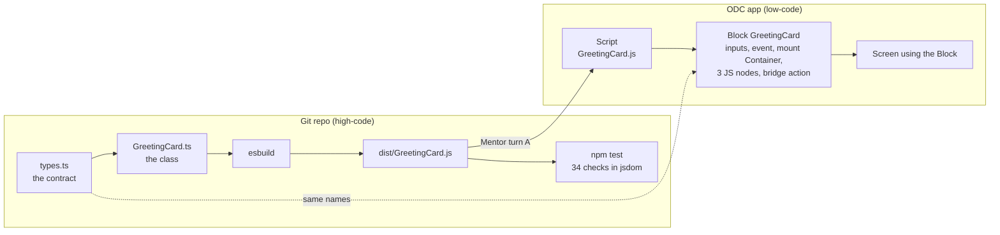

# Building a custom TypeScript pattern for ODC, step by step

A walkthrough you can follow to ship your own front-end pattern: written in TypeScript, kept in Git with a build and tests, and dropped into an ODC app as a Block. The agent does the platform work through the official OutSystems MCP server. **Everything here was run end to end on ODC**, on a throwaway app, and the reference implementation is in [`greeting-card/`](greeting-card/).

This page is the recipe: what to create, in what order, the exact prompts, and how to prove that what got published is what you wrote.

## The idea

Don't try to make Web Components work natively in OutSystems. Use the **Block as a thin bridge** instead: it receives data through Input Parameters, raises Events, and in its lifecycle handlers it creates and drives an instance of a class that lives in a JavaScript bundle built outside the platform. The Block is the small part you see in Studio; the component, with its types, build and tests, is ordinary high-code that evolves in Git and can change without republishing the Block as long as the contract holds.

The technique comes from [*AI-Powered Frontend Development in OutSystems O11 and ODC*](https://antonio-carvalho.medium.com/ai-powered-frontend-development-in-outsystems-o11-and-odc-4d408fdb4ade) by **António Carvalho**. The article also describes it for O11; this page covers ODC only, because that's all we ran. For O11, see [Components_11.md](Components_11.md).

**If your tenant is shared:** Mentor's quota is counted per tenant, so the turns you spend are your colleagues' turns too. Steps 5 and 6 are designed to keep the number of turns low.

## What you end up with



- A **Script** in the app holding your bundle, unchanged.
- A **Block** with Input Parameters, an Event, an empty mount Container and three JS nodes. That's the whole platform side.
- A **screen** using the Block, so you can test it and audit the published JavaScript.
- A repo where the component is ordinary TypeScript: code review, type checks, `npm test`, no publish needed to iterate.

The example component is deliberately small: a card that greets a name and counts clicks. It is small so that every part of the bridge is visible: inputs flowing in, `onParametersChanged`, an event flowing back out through a Client Action, and `destroy`. Swap the class for your real component and the rest stays the same.

## Prerequisites

| What | Why | Notes |
|---|---|---|
| An ODC tenant you can publish to | the target | Personal Edition works. Use a throwaway app |
| Node.js LTS | build and tests | `winget install OpenJS.NodeJS.LTS` on Windows. **Needs admin rights**; if the installer is cancelled at the elevation prompt it exits with `1602` and nothing is installed |
| Claude Code with the `outsystems` plugin | drives Mentor, publish and verification | Install from `OutSystems/outsystems-mcp`, set your tenant hostname, then authenticate once from `/mcp` |
| `curl` and `diff` | verifying the published files | Git Bash has both |

## Step 1: start from the reference layout

Copy [`greeting-card/`](greeting-card/) and rename. The layout:

```
src/index.ts                         registers window.<Namespace>.<Component>
src/greeting-card/types.ts           the contract with the Block
src/greeting-card/GreetingCard.ts    the class
src/greeting-card/styles.ts          layout CSS, injected once into <head>
build.mjs                            esbuild -> dist/GreetingCard.js
test/checks.js                       scripted checks, shared by browser and Node
test/run.mjs                         runs the checks in jsdom (npm test)
preview/index.html                   local page; ?test=1 runs the checks in the browser
```

Four things to rename consistently: the **namespace** (`ClaudeTest` → yours, e.g. `MyCompany`), the **class name**, the **output file**, and the **BEM block** (`greeting-card` → your pattern in kebab-case, in every CSS class, the stylesheet id and the test's BEM check; see [Rule 0](#rules-for-every-custom-pattern)). The namespace is global, so make it unique to your team.

```
npm install
npm test        # typecheck + build + checks
```

## Step 2: write the contract first

`types.ts` is the one file both sides agree on. Write it before the class and before touching the platform. Every name in it becomes a name in the Block.

```ts
// Block Input Parameters -> GreetingCardParameters
//   Name           Text
//   ButtonLabel    Text
//   ExtendedClass  Text, not mandatory, default "" (every pattern has one).
//                  Applied by the Block's main container, NOT by this class,
//                  so it is deliberately absent from GreetingCardParameters.
//
// Block Events -> GreetingCardEvents (each wired through a bridge Client Action)
//   OnGreetClicked(Count: Integer)  <- Client Action TriggerGreetClicked(Count)

export interface GreetingCardParameters {
  name: string;
  buttonLabel: string;
}

export interface GreetingCardEvents {
  OnGreetClicked?: (count: number) => void;
}

export interface GreetingCardConfig extends GreetingCardParameters {
  runtimeId: string;           // the mount Container's runtime id
  events?: GreetingCardEvents;
}
```

The comment block at the top is the most useful thing in the file: when you later write the Mentor prompt for the Block, you copy names straight from it.

### Rules for every custom pattern

Three conventions apply to every pattern we build, so they behave like the patterns in OutSystems UI. Rule 0 is the golden rule: no pattern ships without it.

**Rule 0 (golden rule): every CSS class the pattern owns follows BEM, with the pattern class as the block.**

| BEM part | Form | GreetingCard | Who sets it |
|---|---|---|---|
| Block | `<pattern>` | `greeting-card` | The Block's main container (Rule 2) |
| Element | `<pattern>__<element>` | `greeting-card__body`, `__text`, `__title`, `__count`, `__button` | The TypeScript class |
| Modifier | `<pattern>--<modifier>` or `<pattern>__<element>--<modifier>` | `greeting-card--compact` | A screen, through `ExtendedClass` |

OutSystems UI classes go next to the BEM class, never instead of it (`card greeting-card__body`), and a screen picks a variant by passing a modifier in `ExtendedClass`. The full rule, together with the rest of the CSS rules (OutSystems UI variables with base-theme fallbacks, one-class selectors, device classes, right-to-left, accessibility), is in **[Style.md](Style.md)**. `npm test` enforces the parts a script can check.

**Rule 1: an `ExtendedClass` Input Parameter.**

| Property | Value |
|---|---|
| Name | `ExtendedClass` |
| Type | Text |
| Mandatory | **No** |
| Default | `""` |

It's how a screen adapts one instance (spacing, a theme variant, a utility class) without touching the pattern.

**Rule 2: the pattern's main container carries the pattern class plus `ExtendedClass`.** The main container is the Block's outermost widget, the one the component mounts into (`MountPoint` in GreetingCard). Set its **Style Classes** property to the pattern's own class followed by this expression:

```
"greeting-card" + If(ExtendedClass <> NullTextIdentifier(), " " + ExtendedClass, "")
```

- `"greeting-card"` is the pattern class: always present, so the pattern's look and feel can be targeted and inspected. Name it after the pattern.
- The `If` adds a space and the extra classes only when `ExtendedClass` isn't empty, so an empty value never leaves a trailing space.
- Because it's a platform expression, it updates live when `ExtendedClass` changes. The JavaScript doesn't need to know about it.

**`ExtendedClass` is applied in one place only: that container.** Don't also apply it from the TypeScript class. Doing both puts every class on two nested elements, and a spacing class like `margin-top-m` would add its margin twice. That's why `extendedClass` isn't in `GreetingCardParameters`, isn't passed by the JS nodes, and the class never touches the mount element's own classes. `npm test` checks this last point.

## Step 3: write the class to the bridge's rules

The Block will call exactly three things, so the class needs exactly three members:

| Member | Called from | Rules that matter |
|---|---|---|
| `constructor(config)` | `OnReady` | find the mount by `config.runtimeId`; throw a clear error if it's missing; render once |
| `onParametersChanged(params)` | `OnParametersChanged` | accept a **partial** update; never reset internal state the user created (the count survives a name change) |
| `destroy()` | `OnDestroy` | remove **every** listener and observer; make later calls no-ops instead of throwing |

Plus three habits that saved us debugging time:

- **Platform data enters the DOM through `textContent`, never `innerHTML`.** One of the checks feeds `` as the name and asserts it shows up as text.
- **Reuse OutSystems UI classes for anything themed.** The card uses `card` and the button uses `btn btn-primary`, so it follows the app theme. Each of those elements also carries its BEM class (`greeting-card__body`, `greeting-card__button`), which is what your own stylesheet targets (Rule 0). That stylesheet takes every colour, radius, spacing and shadow from OutSystems UI theme variables (`var(--color-primary, #1068eb)`), with the base theme's value as fallback for the local preview, so it never hard-codes the brand. See [Style.md](Style.md).
- **Inject the stylesheet once**, keyed by an element id, so two instances on one screen don't duplicate it.

See [`GreetingCard.ts`](greeting-card/src/greeting-card/GreetingCard.ts) for the full class (about 80 lines).

## Step 4: build for diffability, not size

```js
// build.mjs
await build({
  entryPoints: ["src/index.ts"],
  outfile: "dist/GreetingCard.js",
  bundle: true,
  format: "iife",       // no module loader on the platform side
  target: "es2019",
  minify: false,        // so the published copy can be diffed against disk
  legalComments: "none",
});
```

Not minifying is the point: step 8 compares the published Script with this file line by line. ODC serves it as is, so you lose nothing.

Commit `dist/` too. It's the artifact that goes to OutSystems, and having it in Git is what lets you answer "is what's live what we reviewed?". Add `* text=auto eol=lf` to `.gitattributes`: Git for Windows converts files to CRLF on checkout by default, which would make every comparison report a difference that isn't really there.

## Step 5: prove it locally before spending agent quota

`npm test` runs `tsc --noEmit`, builds, and then runs [`test/checks.js`](greeting-card/test/checks.js) against the bundle in jsdom:

```
PASS  bundle registers window.ClaudeTest.GreetingCard
PASS  renders inside the mount container
PASS  uses OutSystems UI card and button classes
PASS  every component class is BEM or OutSystems UI
PASS  every variable is an OutSystems UI token with its base-theme fallback
PASS  click fires OnGreetClicked with count 1
PASS  onParametersChanged keeps the count
PASS  markup in data renders as text, not HTML
PASS  container classes (pattern class + ExtendedClass) are untouched on create
PASS  ExtendedClass is not duplicated on the card root
PASS  destroy removes the click listener
PASS  calls after destroy are safe
PASS  missing mount id throws a clear error
...
34/34 passed
```

The same file runs in the browser at `preview/index.html?test=1`. Write a check for every lifecycle rule in step 3; that's what makes AI-written component code safe to accept. Mentor quota is counted per tenant, so every bug caught here is a turn you don't spend.

## Step 6: the platform side in three agent turns

**One element per turn.** In an earlier attempt, sending a Script and a Block in the same turn exhausted the quota (`OS-AISA-42903`) and published nothing; split into separate turns, both passed. Open one Mentor session on the app and keep it for all three turns and the publish. Each turn below took about 1 to 2 minutes and came back with 0 errors and 0 warnings.

### Turn A: the Script

Paste the bundle inline between markers and forbid any rewriting. Only do this for small bundles. A ~106 KB stylesheet sent through Mentor once killed the turn (`OS-AIWA-50001`), while pasting the same file into ODC Studio by hand was instant and used no quota. Rule of thumb: build structure through the agent, paste large content yourself.

```text
Add a new Script resource named "GreetingCard" (file GreetingCard.js) to this app.
Its content must be EXACTLY the JavaScript below, copied literally, character for
character — do not reformat, translate, rename, or "improve" anything. Only add the
Script; do not create Blocks, screens or actions, and do not change anything else.
Do not publish.

----- BEGIN GreetingCard.js -----
<contents of dist/GreetingCard.js>
----- END GreetingCard.js -----
```

### Turn B: the Block

Spell out every element and give the JS verbatim. Copy the names from `types.ts`.

Budget **one bridge Client Action per Event**. Inside an ODC JS node, `$actions` resolves Client Actions only, never a Block Event: `events: { OnGreetClicked: $actions.OnGreetClicked }` is rejected with `Unknown 'OnGreetClicked' action`. The fix is a Client Action whose only step raises the Event, passed into the class instead. It's the most common reason this technique "mysteriously does not fire anything".

The `if ($parameters.Instance)` guards aren't decoration either: `OnParametersChanged` can fire before `OnReady` has finished, and without the guard you get a null reference that's hard to trace back to lifecycle order.

```text
Create a new Block named "GreetingCard". It is a thin bridge to the external class
window.ClaudeTest.GreetingCard defined in the existing "GreetingCard" Script. Only
create this Block. Do not publish.

1. Input Parameters: Name (Text, mandatory, default ""), ButtonLabel (Text, not
   mandatory, default "Greet"), ExtendedClass (Text, NOT mandatory, default "").
2. Event: OnGreetClicked with one input parameter Count (Integer).
3. Local Variable: Instance (Object).
4. Widget tree: a single empty Container named "MountPoint" (the pattern's main
   container). Set its Style Classes to exactly:
   "greeting-card" + If(ExtendedClass <> NullTextIdentifier(), " " + ExtendedClass, "")
5. Required Scripts: add the "GreetingCard" Script.
6. Client Action "TriggerGreetClicked" (input Count, Integer) whose only step is
   Trigger Event OnGreetClicked with Count = Count. (Needed because $actions in a
   JavaScript node cannot reference a Block Event directly.)
7. Three lifecycle handlers, each with one JavaScript node:

OnReady — inputs RuntimeId = MountPoint.Id, Name, ButtonLabel; output Instance,
assigned to the local variable Instance:
$parameters.Instance = new ClaudeTest.GreetingCard({
  runtimeId: $parameters.RuntimeId,
  name: $parameters.Name,
  buttonLabel: $parameters.ButtonLabel,
  events: { OnGreetClicked: $actions.TriggerGreetClicked }
});

OnParametersChanged — inputs Instance, Name, ButtonLabel:
if ($parameters.Instance) {
  $parameters.Instance.onParametersChanged({
    name: $parameters.Name,
    buttonLabel: $parameters.ButtonLabel
  });
}

ExtendedClass is used only by MountPoint's Style Classes. Do not pass it to any
JavaScript node.

OnDestroy — input Instance:
if ($parameters.Instance) {
  $parameters.Instance.destroy();
}

Keep the JavaScript exactly as written, including the guards.
```

### Turn C: a screen that uses it

A Block that no screen uses isn't included in the published JavaScript, so you can't audit it. Build a harness that exercises every direction of the contract: an input bound to a parameter (tests `onParametersChanged`) and a visible reaction to the event (tests the bridge).

```text
On the Home screen, below the existing content, add a test harness for the
GreetingCard Block. Change nothing else. Do not publish.

1. Screen Local Variable VisitorName (Text, default "OutSystems").
2. A Label "Your name" and a Text Input bound to VisitorName.
3. A GreetingCard Block with Name = VisitorName and ButtonLabel = "Say hello".
4. Handle OnGreetClicked with a screen Client Action "GreetingCardOnGreetClicked"
   (input Count, Integer) whose only step is an Info Message:
   "OnGreetClicked fired: Count = " + Count.
```

## Step 7: publish

Publishing is a Mentor turn in the same session: `Publish. Publish note: "<what changed>"`. It took about 30 seconds. A successful run reports the new revision and a publication key; then confirm the environment is actually running it:

> the agent calls `env_app` and checks that the live `revision` equals the revision the publish reported

A "published successfully" message on its own is not that confirmation.

## Step 8: verify what was actually published

### 8a. The Script is your bundle

Every app lists its versioned files at `https://<your-app-url>/moduleservices/moduleinfo`. User Scripts appear as `scripts/<App>.UserScripts.<Name>__<hash>.js`.

```bash
APP=https://<your-app-url>
curl -s "$APP/moduleservices/moduleinfo" | grep -o '/[^"]*UserScripts\.GreetingCard[^"]*\.js'
curl -s -o published.js "https://<your-host>/<that path>"

# strip the BOM ODC adds, then compare
sed '1s/^\xEF\xBB\xBF//' published.js | diff dist/GreetingCard.js - && echo IDENTICAL
```

What we measured on four of those publishes (pure-ASCII bundles; each update was sent as a full replacement of the Script):

| | First publish | `ExtendedClass` update | BEM look-and-feel update | Style.md alignment |
|---|---|---|---|---|
| Local | 2,959 bytes, 80 lines | 3,127 bytes, 84 lines | 5,158 bytes, 138 lines | 5,233 bytes, 147 lines |
| Published | 2,961 bytes | 3,129 bytes | 5,160 bytes | 5,235 bytes |
| BOM added | **yes** (`EF BB BF`, +3 bytes) | **yes** | **yes** | **yes** |
| Final newline | **dropped** (−1 byte) | **dropped** | **dropped** | **dropped** |
| Line endings | LF | LF | LF | LF |
| Code | **identical**, line for line | **identical**, line for line | **identical**, line for line | **identical**, line for line |

The result was the same every time, including a publish not in the table (the main-container rule, which restored the 2,959-byte bundle), so it's repeatable for small files. The BEM update shows it also holds for a bundle carrying a 60-line CSS template literal; it took one Mentor turn for the Script and one to publish.

The container rule is visible in the compiled screen code too: `MountPoint`'s style compiles to `"greeting-card" + (extendedClassIn !== nullTextIdentifier() ? " " + extendedClassIn : "")`, recalculated whenever `ExtendedClass` changes. It's still cleaner than an earlier 21 KB bundle, which came back reindented, with CRLF line endings and one escape sequence inside a comment changed (`\xE7` became `\xE3`). The likely difference is size and content: a small, ASCII-only file with no escape sequences in it. Don't assume you'll get the clean result; always run the diff.

### 8b. The JS nodes are wired as you asked

Download the app's script chunks from the same manifest and search for your class:

```bash
grep -l "ClaudeTest.GreetingCard" *.js
```

In the matching chunk the three nodes compile to small functions. What we found:

```js
function re(r){ r.Instance && r.Instance.destroy() }
function ie(r){ r.Instance && r.Instance.onParametersChanged({name:r.Name, buttonLabel:r.ButtonLabel}) }
function ae(r,n){ r.Instance = new ClaudeTest.GreetingCard({runtimeId:r.RuntimeId, name:r.Name,
  buttonLabel:r.ButtonLabel, events:{OnGreetClicked:n.TriggerGreetClicked}}) }
```

Check four things: the guards survived (the compiler rewrites `if (x) { … }` as `x && …`, which is equivalent), every parameter name matches `types.ts`, **no** `extendedClass` reaches the JS nodes (the container owns it), and the event goes through the bridge action (`n.TriggerGreetClicked`), not the Block Event.

### 8c. It works in a real browser

Validation and the diff are static. Open the screen and click through what the harness was built for:

1. The card renders inside the Block with the starting name.
2. Each click shows the Info message with the count going up (proves the event made it back to OutSystems through the bridge).
3. Typing in the input updates the greeting live (proves `onParametersChanged`).
4. DevTools → Elements: the Block's main container has `greeting-card` plus whatever `ExtendedClass` the screen passes (and nothing extra when it passes none), and the card inside it has exactly `card greeting-card__body`. Every class you see inside the container is `greeting-card__*`, `greeting-card--*` or an OutSystems UI class (Rule 0).
5. DevTools → Console is clean.

## Platform limits we hit along the way

All of these cost a turn or a question.

| What happened | What to do |
|---|---|
| Mentor refused to load a **mobile app**: `Assets of type MobileApplication are not supported. Supported asset types are: WebApplication, Agent, Library, Workflow.` | Build the pattern in a web app or a library. Mobile apps have to be edited in ODC Studio |
| Publishing an app installed from a **sample/Forge** (flagged external in the app list) failed immediately with no reason given; the edit itself had worked | Do these experiments in an app you created. Creating one through the agent takes one call |
| Creating an app failed with `Portfolio ID is required.` | Pass the portfolio key; the environment list returns it |
| The template's Home screen required login | Ask for `AnonymousAccess = true` on the harness screen if colleagues should open it without signing in |
| The OAuth sign-in can't run inside a non-interactive agent session | Authenticate once from `/mcp` in Claude Code before asking for anything |

## Making it yours

1. Copy `greeting-card/`, rename namespace, class and output file.
2. Write `types.ts`: every Input Parameter, every Event and its payload. Every pattern gets `ExtendedClass` (Text, not mandatory, default `""`), documented as applied by the main container, not the class.
3. Write the class to the three-member rules, naming every class BEM under the pattern block (Rule 0, the golden rule); add a check for each rule, including the BEM check and that it leaves the mount element's classes alone; `npm test` until green.
4. Commit, including `dist/`.
5. Turn A (Script), turn B (Block: one bridge Client Action per Event, and the main container's Style Classes set to `"<pattern-class>" + If(ExtendedClass <> NullTextIdentifier(), " " + ExtendedClass, "")`), turn C (harness screen), in one Mentor session.
6. Publish; confirm the live revision.
7. Diff the Script, find the JS nodes, check the container's classes, click through in the browser.
8. Only then use the Block on real screens.

For a component with real behaviour (a data table, a chart, a rich editor) the platform side barely grows: more Input Parameters and more bridge actions, still three JS nodes. The growth is all in the repo, which is where you want it.

## Going further

Not tested here, but the obvious next steps:

- **Structured data.** Pass lists as JSON Text parameters and parse in the class. Paste that JSON by hand rather than through Mentor: a column-configuration JSON once came back rewritten (labels changed, columns reordered, keys translated) while still valid, so nothing failed loudly but nothing matched the data either. Re-read any value that has to match data from the published app.
- **Placeholders.** Let low-code content render inside the component by putting a Placeholder in the Block next to the mount Container and having the class leave it alone.
- **A library instead of an app.** Put the Script and Block in a library so several apps consume one reviewed copy. Mentor can edit libraries; verify through a consuming app, since libraries don't appear in an environment's deployed inventory.

## References

- [`greeting-card/`](greeting-card/): the reference implementation used on this page
- [AI-Powered Frontend Development in OutSystems O11 and ODC](https://antonio-carvalho.medium.com/ai-powered-frontend-development-in-outsystems-o11-and-odc-4d408fdb4ade): António Carvalho, the source of the technique
- [OutSystems/outsystems-mcp](https://github.com/OutSystems/outsystems-mcp): the official MCP server and Claude Code plugin
