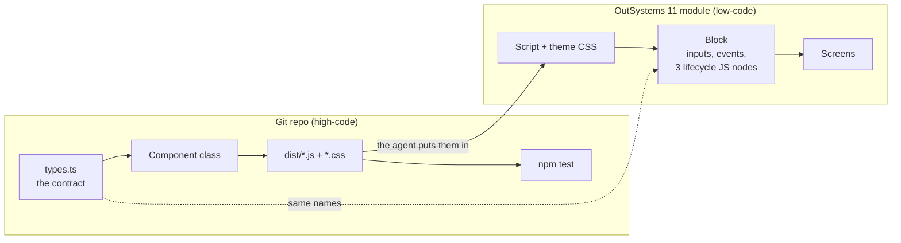

# AI-assisted OutSystems front-end

Build custom front-end patterns for **OutSystems 11** (Reactive Web) the way you build any other front-end code: in TypeScript, in Git, with a build and tests. Then ship them into an app as a Block, with an AI agent doing the platform work through Service Studio.

## How it works

Instead of trying to make Web Components work natively in OutSystems, the **Block is a thin bridge**:



- The **component** is ordinary TypeScript and CSS: types, a class, a stylesheet, tests. It's reviewed and versioned in Git and built into an unminified JS bundle and a stylesheet.
- The **Block** only receives Input Parameters, raises Events, and in `OnReady`, `OnParametersChanged` and `OnDestroy` creates, updates and destroys an instance of the class.
- The **agent** does the platform side through Service Studio's MCP server, on the module you have open: it adds the Script and the stylesheet, creates the Block, and helps verify that what's live is what you reviewed. You review every change in Service Studio's Compare-and-Merge window.

**Status:** the repo side (steps 1 to 5) is built and tested. The Service Studio workflow has been used to build and publish screens on O11, but a component's full platform side (steps 6 to 8) **hasn't been run end to end yet**; the guide says so where it applies.

## Start here

Building a new component? Follow **[docs/NewComponent.md](docs/NewComponent.md)**, a step-by-step checklist from naming it to proving it live. The pages below are what it links to.

1. **[Components.md](docs/Components.md)**: the idea, the rules every pattern follows, and steps 1 to 5 (contract, class, CSS, build, local tests).
2. **[Style.md](docs/Style.md)**: the CSS rules every pattern follows.
   **[AppGuidelines.md](docs/AppGuidelines.md)**: the rules for the screens around them, such as which layout to use.
3. **[Components_11.md](docs/Components_11.md)**: steps 6 to 8 in OutSystems 11. Script, stylesheet, Block and harness screen through the agent, then publish and verify, with the exact requests.
4. **[`components/greeting-card/`](components/greeting-card/)**: a worked example to copy. It's deliberately small (a card that greets a name and counts clicks), so every part of the bridge is visible. Replace the class with your own component; the rest stays the same.

## Rules every pattern follows

| Rule | In short | Details |
|---|---|---|
| **BEM class names** (the golden rule) | The pattern class is the block; everything inside is `<pattern>__<element>`, variants are `<pattern>--<modifier>` | [Style.md, Rule 0](docs/Style.md#rule-0-the-golden-rule-bem-class-names) |
| **OutSystems UI is the base theme** | OutSystems UI classes go next to the BEM class; every colour, space, radius, shadow and font value is an OutSystems UI variable with its base-theme fallback | [Style.md, Rules 1 and 2](docs/Style.md#rule-1-outsystems-ui-classes-go-next-to-the-bem-class-never-instead-of-it) |
| **`ExtendedClass` on every pattern** | A Text Input Parameter, not mandatory, default `""`, so a screen can add classes or pick a modifier | [Components.md, Rule 1](docs/Components.md#rules-for-every-custom-pattern) |
| **The main container carries the classes** | The Block's outermost Container has Style Classes `"<pattern>" + If(ExtendedClass <> NullTextIdentifier(), " " + ExtendedClass, "")`; the component never applies `ExtendedClass` itself | [Components.md, Rule 2](docs/Components.md#rules-for-every-custom-pattern) |
| **The class has three members** | `constructor`, `onParametersChanged` (partial updates, keeps state), `destroy` (removes every listener); platform data enters the DOM as text only | [Components.md, step 3](docs/Components.md#step-3-write-the-class-to-the-bridges-rules) |
| **Events go through a bridge Client Action** | In a JS node, `$actions` reaches Client Actions only, so each Block Event is raised by a Client Action passed into the class | [Components.md, step 3](docs/Components.md#what-the-block-does-with-it) |

`npm test` enforces the rules a script can check: BEM class names and selectors, OutSystems UI variables and their fallbacks, no raw colours or `!important`, logical properties, focus left to OutSystems UI, the container's classes left alone, CSS kept out of the JavaScript, and the lifecycle.

## Try the example locally

Needs Node.js LTS. Every command runs from the repo root: the components are npm workspaces, so one install serves all of them.

```bash
npm install     # once, for every component
npm test        # every component: typecheck, build, then the checks in jsdom
```

To work on one component, run its tests alone with `npm test -w components/greeting-card`, or run `npm test` inside its folder. Then open `components/greeting-card/preview/index.html` in a browser to see the component, or add `?test=1` to run the same checks there. No OutSystems environment is needed for any of this.

To build **every** component for a release:

```bash
npm run build:all
```

It runs each component's `npm test`, stops at the first failure, and writes two files, each starting with a header that gives the same version, build timestamp and contents:

```
/*!
 * Version: 2026.42.1
 * OutSystems front-end components
 * Built: 2026-10-15T10:55:17.753Z
 * Contains:
 *   components/greeting-card/dist/GreetingCard.js
 */
```

The **version** is `<ISO year>.<ISO week>.<N>` from the build's UTC date, with no padding (for example `2026.42.1`). Weeks follow ISO 8601: they start on Monday, and the week's Thursday decides its year, so 31 Dec 2029 is `2030.1.N`. N counts committed releases within the week: one more than the version in the last committed `dist/components.js` if that's from the same week, otherwise 1. Test builds don't use up numbers, which is why the files are committed only when they're uploaded.

The two files:

- `dist/components.js`: every component's JavaScript, added to the module as one Script.
- `dist/components.css`: every component's stylesheet, pasted into the module's theme stylesheet. Components never inject their own CSS.

Before writing them, it smoke-tests both: `components.js` must load and register every component, and `components.css` must style every component and nothing outside their blocks. Upload both from the same build. Add `-- --no-test` to skip the tests during local experiments, never for something going to OutSystems.

To start your own component, copy `components/greeting-card/` into `components/<your-component>/` and rename four things consistently: the global namespace (`ClaudeTest`), the class, the output files, and the BEM block (`greeting-card`). `node .claude/skills/new-pattern/scaffold.mjs <Pattern> <Namespace>` does all of it; then run `npm install` at the root to register the new workspace.

## Repository layout

```
README.md               this page
CLAUDE.md               standing rules for the AI agent working in this repo
package.json            npm workspaces (components/*) and the test / build:all commands
package-lock.json       the one lockfile for every component
docs/
  Components.md         the idea, the rules and steps 1 to 5
  Components_11.md      steps 6 to 8 in OutSystems 11, and working with the Service Studio MCP
  Style.md              CSS rules for every component
  AppGuidelines.md      rules for app screens (layout, placeholders, classes)
  NewComponent.md       step-by-step checklist for building a new component
components/             one folder per component, each an npm workspace
  greeting-card/        the example component new ones are copied from
    src/                contract (types.ts), class, global registration
    style/              the component's CSS (greeting-card.css)
    dist/               GreetingCard.js and GreetingCard.css, what goes to OutSystems, committed on purpose
    test/               checks shared by jsdom and the browser
    preview/            local page to see and test the component
scripts/
  build-all.mjs         builds every component and joins the output into dist/components.js and .css
dist/
  components.js         every component's JavaScript, with the build timestamp at the top
  components.css        every component's stylesheet, with the same timestamp
.claude/skills/
  new-pattern/          copy greeting-card into components/ and rename it consistently (scaffold.mjs)
```

`dist/components.js` and `dist/components.css` include every folder in `components/`, the example included, so remove or move `greeting-card/` once real components replace it.

With Claude Code, the `new-pattern` skill turns starting a component into one request: "create a StatusBadge component".

## Credits

The Block-as-bridge technique comes from [*AI-Powered Frontend Development in OutSystems O11 and ODC*](https://antonio-carvalho.medium.com/ai-powered-frontend-development-in-outsystems-o11-and-odc-4d408fdb4ade) by António Carvalho. The example reuses OutSystems UI class names and variables (BSD-3-Clause) and copies none of its code.
