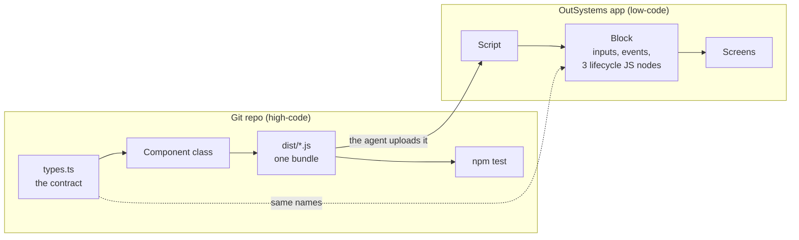

# AI-assisted OutSystems front-end

Build custom front-end patterns for OutSystems the way you build any other front-end code: in TypeScript, in Git, with a build and tests. Then ship them into an app as a Block, with an AI agent doing the platform work. It works on both platforms: **ODC** (OutSystems Developer Cloud) and **O11** (OutSystems 11, Reactive Web).

## How it works

Instead of trying to make Web Components work natively in OutSystems, the **Block is a thin bridge**:



- The **component** is ordinary TypeScript: types, a class, its own CSS, tests. It's reviewed and versioned in Git and built into a single unminified bundle.
- The **Block** only receives Input Parameters, raises Events, and in `OnReady`, `OnParametersChanged` and `OnDestroy` creates, updates and destroys an instance of the class.
- The **agent** does the platform side through an MCP server: it uploads the bundle as a Script, creates the Block, publishes, and helps verify that what's live is what you reviewed.

## One pattern, two platforms

The repo side is identical. Only the platform side changes:

| | ODC | O11 |
|---|---|---|
| Agent's channel | The official OutSystems MCP server, on your tenant | Service Studio's own MCP server, on your machine |
| Who edits the app | Mentor, the ODC AI agent, from plain-language prompts | The agent itself, with OutSystems Model API code |
| Reviewing a change | Mentor's run results | Service Studio's Compare-and-Merge window |
| Cost | Mentor turns, counted per tenant | None |
| Publishing | A Mentor turn | 1-Click Publish |
| Module types | Web apps and libraries | Reactive Web apps and libraries (not Traditional Web) |
| Status | **Run end to end.** On every publish, the published Script matched the local bundle line for line (ODC only adds a BOM and drops the final newline) | **Written, not yet run end to end** |
| Guide | [Components_ODC.md](Components_ODC.md) | [Components_11.md](Components_11.md) |

## Start here

1. **[Style.md](Style.md)**: the CSS rules every pattern follows, on both platforms.
2. **The guide for your platform**: [Components_ODC.md](Components_ODC.md) or [Components_11.md](Components_11.md). Each one goes step by step from the contract to a verified publish, with the exact prompts.
3. **[`greeting-card/`](greeting-card/)**: a worked example to copy. It's deliberately small (a card that greets a name and counts clicks), so every part of the bridge is visible. Replace the class with your own component; the rest stays the same.

## Rules every pattern follows

| Rule | In short | Details |
|---|---|---|
| **BEM class names** (the golden rule) | The pattern class is the block; everything inside is `<pattern>__<element>`, variants are `<pattern>--<modifier>` | [Style.md, Rule 0](Style.md#rule-0-the-golden-rule-bem-class-names) |
| **OutSystems UI is the base theme** | OutSystems UI classes go next to the BEM class; every colour, space, radius, shadow and font value is an OutSystems UI variable with its base-theme fallback | [Style.md, Rules 1 and 2](Style.md#rule-1-outsystems-ui-classes-go-next-to-the-bem-class-never-instead-of-it) |
| **`ExtendedClass` on every pattern** | A Text Input Parameter, not mandatory, default `""`, so a screen can add classes or pick a modifier | [ODC guide, Rule 1](Components_ODC.md#rules-for-every-custom-pattern) |
| **The main container carries the classes** | The Block's outermost Container has Style Classes `"<pattern>" + If(ExtendedClass <> NullTextIdentifier(), " " + ExtendedClass, "")`; the component never applies `ExtendedClass` itself | [ODC guide, Rule 2](Components_ODC.md#rules-for-every-custom-pattern) |
| **The class has three members** | `constructor`, `onParametersChanged` (partial updates, keeps state), `destroy` (removes every listener); platform data enters the DOM as text only | [ODC guide, step 3](Components_ODC.md#step-3-write-the-class-to-the-bridges-rules) |
| **Events go through a bridge Client Action** | In a JS node, `$actions` reaches Client Actions only, so each Block Event is raised by a Client Action passed into the class | [ODC guide, turn B](Components_ODC.md#turn-b-the-block) |

`npm test` enforces the rules a script can check: BEM class names, OutSystems UI variables and their fallbacks, no raw colours, no `!important`, the container's classes left alone, and the lifecycle.

## Try the example locally

Needs Node.js LTS.

```bash
cd greeting-card
npm install
npm test        # typecheck, build, then the checks in jsdom
```

Then open `greeting-card/preview/index.html` in a browser to see the component, or `preview/index.html?test=1` to run the same checks there. No OutSystems environment is needed for any of this.

To start your own pattern, copy `greeting-card/` and rename four things consistently: the global namespace (`ClaudeTest`), the class, the output file, and the BEM block (`greeting-card`).

## Repository layout

```
README.md               this page
Style.md                CSS rules for every pattern, both platforms
Components_ODC.md       step-by-step guide for ODC (run end to end)
Components_11.md        step-by-step guide for O11 Reactive (not yet run)
greeting-card/          the example pattern
  src/                  contract (types.ts), class, styles, global registration
  dist/                 the bundle that goes to OutSystems, committed on purpose
  test/                 checks shared by jsdom and the browser
  preview/              local page to see and test the component
```

## Credits

The Block-as-bridge technique comes from [*AI-Powered Frontend Development in OutSystems O11 and ODC*](https://antonio-carvalho.medium.com/ai-powered-frontend-development-in-outsystems-o11-and-odc-4d408fdb4ade) by António Carvalho. The example reuses OutSystems UI class names and variables (BSD-3-Clause) and copies none of its code.
