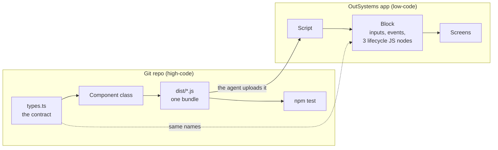

# AI-assisted OutSystems front-end

Build custom front-end patterns for OutSystems the way you build any other front-end code: in TypeScript, in Git, with a build and tests. Then ship them into an app as a Block, with an AI agent doing the platform work. It works on both platforms: **ODC** (OutSystems Developer Cloud) and **O11** (OutSystems 11, Reactive Web).

## How it works

Instead of trying to make Web Components work natively in OutSystems, the **Block is a thin bridge**:



- The **component** is ordinary TypeScript: types, a class, its own CSS, tests. It's reviewed and versioned in Git and built into a single unminified bundle.
- The **Block** only receives Input Parameters, raises Events, and in `OnReady`, `OnParametersChanged` and `OnDestroy` creates, updates and destroys an instance of the class.
- The **agent** does the platform side through an MCP server: it uploads the bundle as a Script, creates the Block, publishes, and helps verify that what's live is what you reviewed.

## One pattern, two platforms

The repo side is identical. Only the platform side changes:

| | ODC | O11 |
|---|---|---|
| Agent's channel | The official OutSystems MCP server, on your tenant | Service Studio's own MCP server, on your machine |
| Who edits the app | Mentor, the ODC AI agent, from plain-language prompts | The agent itself, with OutSystems Model API code |
| Reviewing a change | Mentor's run results | Service Studio's Compare-and-Merge window |
| Cost | Mentor turns, counted per tenant | None |
| Publishing | A Mentor turn | 1-Click Publish |
| Module types | Web apps and libraries | Reactive Web apps and libraries (not Traditional Web) |
| Status | **Run end to end.** On every publish, the published Script matched the local bundle line for line (ODC only adds a BOM and drops the final newline) | **Written, not yet run end to end** |
| Guide (steps 6 to 8) | [Components_ODC.md](docs/Components_ODC.md) | [Components_11.md](docs/Components_11.md) |

## Start here

Building a new component? Follow **[docs/NewComponent.md](docs/NewComponent.md)**, a step-by-step checklist from naming it to proving it live. The pages below are what it links to.

1. **[Components.md](docs/Components.md)**: the idea, the rules every pattern follows, and steps 1 to 5 (contract, class, build, local tests). The same on both platforms.
2. **[Style.md](docs/Style.md)**: the CSS rules every pattern follows.
   **[AppGuidelines.md](docs/AppGuidelines.md)**: the rules for the screens around them, such as which layout to use.
3. **Steps 6 to 8 for your platform**: [Components_ODC.md](docs/Components_ODC.md) or [Components_11.md](docs/Components_11.md). Script, Block and harness screen through the agent, then publish and verify, with the exact prompts.
4. **[`components/greeting-card/`](components/greeting-card/)**: a worked example to copy. It's deliberately small (a card that greets a name and counts clicks), so every part of the bridge is visible. Replace the class with your own component; the rest stays the same.

## Rules every pattern follows

| Rule | In short | Details |
|---|---|---|
| **BEM class names** (the golden rule) | The pattern class is the block; everything inside is `<pattern>__<element>`, variants are `<pattern>--<modifier>` | [Style.md, Rule 0](docs/Style.md#rule-0-the-golden-rule-bem-class-names) |
| **OutSystems UI is the base theme** | OutSystems UI classes go next to the BEM class; every colour, space, radius, shadow and font value is an OutSystems UI variable with its base-theme fallback | [Style.md, Rules 1 and 2](docs/Style.md#rule-1-outsystems-ui-classes-go-next-to-the-bem-class-never-instead-of-it) |
| **`ExtendedClass` on every pattern** | A Text Input Parameter, not mandatory, default `""`, so a screen can add classes or pick a modifier | [Components.md, Rule 1](docs/Components.md#rules-for-every-custom-pattern) |
| **The main container carries the classes** | The Block's outermost Container has Style Classes `"<pattern>" + If(ExtendedClass <> NullTextIdentifier(), " " + ExtendedClass, "")`; the component never applies `ExtendedClass` itself | [Components.md, Rule 2](docs/Components.md#rules-for-every-custom-pattern) |
| **The class has three members** | `constructor`, `onParametersChanged` (partial updates, keeps state), `destroy` (removes every listener); platform data enters the DOM as text only | [Components.md, step 3](docs/Components.md#step-3-write-the-class-to-the-bridges-rules) |
| **Events go through a bridge Client Action** | In a JS node, `$actions` reaches Client Actions only, so each Block Event is raised by a Client Action passed into the class | [Components.md, step 3](docs/Components.md#what-the-block-does-with-it) |

`npm test` enforces the rules a script can check: BEM class names and selectors, OutSystems UI variables and their fallbacks, no raw colours or `!important`, logical properties, focus left to OutSystems UI, the container's classes left alone, and the lifecycle.

## Try the example locally

Needs Node.js LTS. Every command runs from the repo root: the components are npm workspaces, so one install serves all of them.

```bash
npm install     # once, for every component
npm test        # every component: typecheck, build, then the checks in jsdom
```

To work on one component, run its tests alone with `npm test -w components/greeting-card`, or run `npm test` inside its folder. Then open `components/greeting-card/preview/index.html` in a browser to see the component, or add `?test=1` to run the same checks there. No OutSystems environment is needed for any of this.

To build **every** component into one file:

```bash
npm run build:all
```

It runs each component's `npm test`, stops at the first failure, and writes `dist/components.js`: a header with the build timestamp and the list of bundles it contains, then each component's bundle in alphabetical order. Upload that single file as one Script instead of one Script per component. Add `-- --no-test` to skip the tests during local experiments, never for something going to OutSystems.

To start your own component, copy `components/greeting-card/` into `components/<your-component>/` and rename four things consistently: the global namespace (`ClaudeTest`), the class, the output file, and the BEM block (`greeting-card`). `node .claude/skills/new-pattern/scaffold.mjs <Pattern> <Namespace>` does all of it; then run `npm install` at the root to register the new workspace.

## Repository layout

```
README.md               this page
CLAUDE.md               standing rules for the AI agent working in this repo
package.json            npm workspaces (components/*) and the test / build:all commands
package-lock.json       the one lockfile for every component
docs/
  Components.md         the idea, the rules and steps 1 to 5, both platforms
  Components_ODC.md     steps 6 to 8 on ODC (run end to end)
  Components_11.md      steps 6 to 8 on O11 Reactive (not yet run)
  Style.md              CSS rules for every component, both platforms
  AppGuidelines.md      rules for app screens (layout, placeholders, classes), both platforms
  NewComponent.md       step-by-step checklist for building a new component
components/             one folder per component, each an npm workspace
  greeting-card/        the example component new ones are copied from
    src/                contract (types.ts), class, styles, global registration
    dist/               the bundle that goes to OutSystems, committed on purpose
    test/               checks shared by jsdom and the browser
    preview/            local page to see and test the component
scripts/
  build-all.mjs         builds every component and joins the bundles into dist/components.js
dist/
  components.js         all components in one file, with the build timestamp at the top
.claude/skills/
  new-pattern/          copy greeting-card into components/ and rename it consistently (scaffold.mjs)
  publish-pattern-odc/  republish a component's Script to ODC and verify it (verify-script.sh)
```

`dist/components.js` includes every folder in `components/`, the example included, so remove or move `greeting-card/` once real components replace it.

With Claude Code, the two skills turn the repetitive parts into one request: "create a StatusBadge pattern" or "republish GreetingCard to ODC".

## Credits

The Block-as-bridge technique comes from [*AI-Powered Frontend Development in OutSystems O11 and ODC*](https://antonio-carvalho.medium.com/ai-powered-frontend-development-in-outsystems-o11-and-odc-4d408fdb4ade) by António Carvalho. The example reuses OutSystems UI class names and variables (BSD-3-Clause) and copies none of its code.
