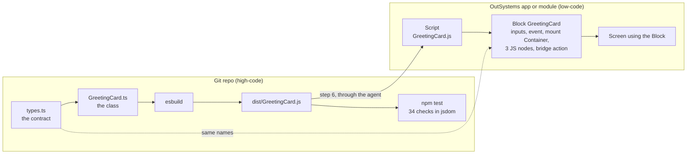

# Building a custom TypeScript pattern, step by step

How to build your own front-end pattern: written in TypeScript, kept in Git with a build and tests, and shipped into an OutSystems 11 (Reactive Web) module as a Block, with an AI agent doing the platform work through Service Studio. This page covers the idea, the rules, and steps 1 to 5, everything done in the repo. Steps 6 to 8, in OutSystems, are in [Components_11.md](Components_11.md): Model API edits reviewed in Service Studio, 1-Click Publish, verify. Those platform steps **haven't been run end to end yet** for a component.

The CSS rules every pattern follows are in [Style.md](Style.md). The worked example used on this page is [`greeting-card/`](../components/greeting-card/).

## The idea

Don't try to make Web Components work natively in OutSystems. Use the **Block as a thin bridge** instead: it receives data through Input Parameters, raises Events, and in its lifecycle handlers it creates and drives an instance of a class that lives in a JavaScript bundle built outside the platform. The Block is the small part you see in Studio; the component, with its types, build and tests, is ordinary high-code that evolves in Git and can change without republishing the Block as long as the contract holds.

The technique comes from [*AI-Powered Frontend Development in OutSystems O11 and ODC*](https://antonio-carvalho.medium.com/ai-powered-frontend-development-in-outsystems-o11-and-odc-4d408fdb4ade) by **António Carvalho**.

## What you end up with



- A **Script** in the app holding your bundle, unchanged.
- A **Block** with Input Parameters, an Event, an empty mount Container and three JS nodes. That's the whole platform side.
- A **screen** using the Block, so you can test it and audit the published JavaScript.
- A repo where the component is ordinary TypeScript: code review, type checks, `npm test`, no publish needed to iterate.

The example component is deliberately small: a card that greets a name and counts clicks. It is small so that every part of the bridge is visible: inputs flowing in, `onParametersChanged`, an event flowing back out through a Client Action, and `destroy`. Swap the class for your real component and the rest stays the same.

## Prerequisites for steps 1 to 5

| What | Why | Notes |
|---|---|---|
| Node.js LTS | Build and tests | `winget install OpenJS.NodeJS.LTS` on Windows. **Needs admin rights**; if the installer is cancelled at the elevation prompt it exits with `1602` and nothing is installed |
| Git | The component lives in a repo | Keep `* text=auto eol=lf` in `.gitattributes` (step 4) |

Nothing in steps 1 to 5 needs an OutSystems environment. [Components_11.md](Components_11.md#prerequisites) lists what step 6 onwards needs.

## Step 1: start from the example

Copy [`greeting-card/`](../components/greeting-card/) and rename. With Claude Code, ask for a new pattern (the `new-pattern` skill), or run the script it uses:

```bash
node .claude/skills/new-pattern/scaffold.mjs <Pattern> <Namespace>    # e.g. StatusBadge MyCompany
```

The layout:

```
src/index.ts                         registers window.<Namespace>.<Component>
src/greeting-card/types.ts           the contract with the Block
src/greeting-card/GreetingCard.ts    the class
style/greeting-card.css              the component's CSS, shipped as its own stylesheet
build.mjs                            esbuild -> dist/GreetingCard.js; style/ -> dist/GreetingCard.css
test/checks.js                       scripted checks, shared by browser and Node
test/run.mjs                         runs the checks in jsdom (npm test)
preview/index.html                   local page; ?test=1 runs the checks in the browser
```

Four things to rename consistently: the **namespace** (`ClaudeTest` → yours, e.g. `MyCompany`), the **class name**, the **output file**, and the **BEM block** (`greeting-card` → your pattern in kebab-case, in every CSS class, the stylesheet's file name and the tests; see [Rule 0](#rules-for-every-custom-pattern)). The namespace is global, so make it unique to your team.

```
npm install
npm test        # typecheck + build + checks
```

## Step 2: write the contract first

`types.ts` is the one file both sides agree on. Write it before the class and before touching the platform. Every name in it becomes a name in the Block.

```ts
// Block Input Parameters -> GreetingCardParameters
//   Name           Text
//   ButtonLabel    Text
//   ExtendedClass  Text, not mandatory, default "" (every pattern has one).
//                  Applied by the Block's main container, NOT by this class,
//                  so it is deliberately absent from GreetingCardParameters.
//                  Modifiers it accepts: greeting-card--compact
//
// Block Events -> GreetingCardEvents (each wired through a bridge Client Action)
//   OnGreetClicked(Count: Integer)  <- Client Action TriggerGreetClicked(Count)

export interface GreetingCardParameters {
  name: string;
  buttonLabel: string;
}

export interface GreetingCardEvents {
  OnGreetClicked?: (count: number) => void;
}

export interface GreetingCardConfig extends GreetingCardParameters {
  runtimeId: string;           // the mount Container's runtime id
  events?: GreetingCardEvents;
}
```

The comment block at the top is the most useful thing in the file: when you later ask the agent for the Block, you copy names straight from it.

### Rules for every custom pattern

Three conventions apply to every pattern, so they behave like the patterns in OutSystems UI. Rule 0 is the golden rule: no pattern ships without it.

**Rule 0 (golden rule): every CSS class the pattern owns follows BEM, with the pattern class as the block.**

| BEM part | Form | GreetingCard | Who sets it |
|---|---|---|---|
| Block | `<pattern>` | `greeting-card` | The Block's main container (Rule 2) |
| Element | `<pattern>__<element>` | `greeting-card__body`, `__text`, `__title`, `__count`, `__button` | The TypeScript class |
| Modifier | `<pattern>--<modifier>` or `<pattern>__<element>--<modifier>` | `greeting-card--compact` | A screen, through `ExtendedClass` |

OutSystems UI classes go next to the BEM class, never instead of it (`card greeting-card__body`), and a screen picks a variant by passing a modifier in `ExtendedClass`. The full rule, together with the rest of the CSS rules (OutSystems UI variables with base-theme fallbacks, one-class selectors, device classes, right-to-left, accessibility), is in **[Style.md](Style.md)**. `npm test` enforces the parts a script can check.

**Rule 1: an `ExtendedClass` Input Parameter.**

| Property | Value |
|---|---|
| Name | `ExtendedClass` |
| Type | Text |
| Mandatory | **No** |
| Default | `""` |

It's how a screen adapts one instance (spacing, a theme variant, a utility class) without touching the pattern.

**Rule 2: the pattern's main container carries the pattern class plus `ExtendedClass`.** The main container is the Block's outermost widget, the one the component mounts into (`MountPoint` in GreetingCard). Set its **Style Classes** property to the pattern's own class followed by this expression, which is a standard OutSystems expression:

```
"greeting-card" + If(ExtendedClass <> NullTextIdentifier(), " " + ExtendedClass, "")
```

- `"greeting-card"` is the pattern class, the BEM block: always present, so the pattern's look and feel can be targeted and inspected.
- The `If` adds a space and the extra classes only when `ExtendedClass` isn't empty, so an empty value never leaves a trailing space.
- Because it's a platform expression, it updates live when `ExtendedClass` changes. The JavaScript doesn't need to know about it.

**`ExtendedClass` is applied in one place only: that container.** Don't also apply it from the TypeScript class. Doing both puts every class on two nested elements, and a spacing class like `margin-top-m` would add its margin twice. That's why `extendedClass` isn't in `GreetingCardParameters`, isn't passed by the JS nodes, and the class never touches the mount element's own classes. `npm test` checks this last point.

## Step 3: write the class to the bridge's rules

The Block will call exactly three things, so the class needs exactly three members:

| Member | Called from | Rules that matter |
|---|---|---|
| `constructor(config)` | `OnReady` | find the mount by `config.runtimeId`; throw a clear error if it's missing; render once |
| `onParametersChanged(params)` | `OnParametersChanged` | accept a **partial** update; never reset internal state the user created (the count survives a name change) |
| `destroy()` | `OnDestroy` | remove **every** listener and observer; make later calls no-ops instead of throwing |

Plus three habits that saved us debugging time:

- **Platform data enters the DOM through `textContent`, never `innerHTML`.** One of the checks feeds `` as the name and asserts it shows up as text.
- **Reuse OutSystems UI classes for anything themed.** The card uses `card` and the button uses `btn btn-primary`, so it follows the app theme. Each of those elements also carries its BEM class (`greeting-card__body`, `greeting-card__button`), which is what your own stylesheet targets. That stylesheet takes every colour, radius, spacing and shadow from OutSystems UI variables, with the base theme's value as fallback for the local preview. See [Style.md](Style.md).
- **Keep the CSS out of the class.** It lives in `style/<pattern>.css` and ships as a stylesheet of its own (`dist/<Name>.css`), so the class never injects styles and two instances on one screen can't duplicate them. It goes in the app's theme stylesheet, not the Block's: on O11, Block stylesheet edits don't reliably publish through the agent. See [Style.md, Rule 7](Style.md#rule-7-where-a-patterns-css-lives).

See [`GreetingCard.ts`](../components/greeting-card/src/greeting-card/GreetingCard.ts) for the full class (about 80 lines).

### What the Block does with it

Step 6 builds this in OutSystems. Two of its parts need explaining:

- **One bridge Client Action per Event.** Inside a JavaScript node, `$actions` reaches Client Actions only, never a Block Event. So each Event gets a Client Action whose only step triggers it, and that action is what's passed into the class (`events: { OnGreetClicked: $actions.TriggerGreetClicked }`). Passing the Event directly is rejected with `Unknown 'OnGreetClicked' action`; it's the most common reason this technique "mysteriously does not fire anything".
- **Guards in `OnParametersChanged` and `OnDestroy`** (`if ($parameters.Instance) { … }`). `OnParametersChanged` can fire before `OnReady` has finished, and without the guard you get a null reference that's hard to trace back to lifecycle order.

## Step 4: build for diffability, not size

```js
// build.mjs
await build({
  entryPoints: ["src/index.ts"],
  outfile: "dist/GreetingCard.js",
  bundle: true,
  format: "iife",       // no module loader on the platform side
  target: "es2019",
  minify: false,        // so the published copy can be diffed against disk
  legalComments: "none",
});
```

Not minifying is the point: step 8 compares the published Script with this file line by line. Compare the published copy with this file before trusting it; the platform may add a byte-order mark or drop the final newline, but the code itself should match line for line.

Commit `dist/` too. It's the artifact that goes to OutSystems, and having it in Git is what lets you answer "is what's live what we reviewed?". Keep `* text=auto eol=lf` in `.gitattributes`: Git for Windows converts files to CRLF on checkout by default, which would make every comparison report a difference that isn't really there. Keep the bundle ASCII-only too; content with escape sequences has come back altered from a publish.

Each component's build also writes `dist/<Name>.css` from its `style/` folder: every `.css` file there, joined in alphabetical order.

**Several components, one release.** `npm run build:all` at the repo root runs every component's `npm test` and writes two files, each starting with a header that gives the same version, build timestamp (UTC) and contents. The **version** is `<ISO year>.<ISO week>.<N>` from the build's UTC date, with no padding (for example `2026.42.1`). Weeks follow ISO 8601: they start on Monday, and the week's Thursday decides its year, so 31 Dec 2029 is `2030.1.N`. N counts committed releases within the week: one more than the version in the last committed `dist/components.js` if that's from the same week, otherwise 1. Test builds don't use up numbers, which is why the files are committed only when they're uploaded. The two files:

- `dist/components.js`: every component's bundle, with `"use strict"` declared once at the top. Ship it as one Script (for example `Components`) instead of one Script per component.
- `dist/components.css`: every component's stylesheet. Ship it in the app's theme stylesheet ([Style.md, Rule 7](Style.md#rule-7-where-a-patterns-css-lives)).

Upload both files from the same build, so their timestamps match, and check them after publishing the same way as a single bundle: the published Script must match `dist/components.js`. Every build gets a new timestamp, so rebuild just before uploading and commit the files you uploaded.

## Step 5: prove it locally before going to the platform

`npm test` runs `tsc --noEmit`, builds, and then runs [`test/checks.js`](../components/greeting-card/test/checks.js) against the bundle in jsdom:

```
PASS  bundle registers window.ClaudeTest.GreetingCard
PASS  renders inside the mount container
PASS  uses OutSystems UI card and button classes
PASS  every component class is BEM or OutSystems UI
PASS  every variable is an OutSystems UI token with its base-theme fallback
PASS  click fires OnGreetClicked with count 1
PASS  onParametersChanged keeps the count
PASS  markup in data renders as text, not HTML
PASS  container classes (pattern class + ExtendedClass) are untouched on create
PASS  ExtendedClass is not duplicated on the card root
PASS  destroy removes the click listener
PASS  calls after destroy are safe
PASS  missing mount id throws a clear error
...
34/34 passed
```

The same file runs in the browser at `preview/index.html?test=1`. Write a check for every lifecycle rule in step 3; that's what makes AI-written component code safe to accept. Every bug caught here is a round trip through Service Studio you don't make.

## Steps 6 to 8: ship it in OutSystems 11

| Step | What happens | Guide |
|---|---|---|
| 6. Platform side | Script, stylesheet, Block and harness screen, each a Model API edit reviewed in Compare-and-Merge | [Components_11.md, step 6](Components_11.md#step-6-the-platform-side-reviewed-in-service-studio) |
| 7. Publish | 1-Click Publish, then check the module version | [Components_11.md, step 7](Components_11.md#step-7-publish) |
| 8. Verify | Diff the published Script and stylesheet, find the JS nodes, click through | [Components_11.md, step 8](Components_11.md#step-8-verify-what-was-actually-published) |

## Making it yours

1. Copy `components/greeting-card/` into `components/<your-component>/` with the `new-pattern` skill or `scaffold.mjs`, then run `npm install` at the repo root.
2. Write `types.ts`: every Input Parameter, every Event and its payload, and the modifiers `ExtendedClass` accepts. Every pattern gets `ExtendedClass` (Text, not mandatory, default `""`), documented as applied by the main container, not the class.
3. Write the class to the three-member rules and the CSS to [Style.md](Style.md); keep every structural check and add one for each new behaviour; `npm test` until green.
4. Commit, including `dist/`.
5. Steps 6 to 8 in [Components_11.md](Components_11.md): Script, stylesheet, Block (one bridge Client Action per Event; the main container's Style Classes set to `"<pattern>" + If(ExtendedClass <> NullTextIdentifier(), " " + ExtendedClass, "")`), harness screen, publish, verify.
6. Only then use the Block on real screens.

For a component with real behaviour (a data table, a chart, a rich editor) the platform side barely grows: more Input Parameters and more bridge actions, still three JS nodes. The growth is all in the repo, which is where you want it.

## Going further

Not tested here, but the obvious next steps:

- **Structured data.** Pass lists as JSON Text parameters and parse in the class. Don't have an AI agent retype that JSON from a prompt: a column-configuration JSON once came back rewritten that way (labels changed, columns reordered, keys translated) while still valid, so nothing failed loudly but nothing matched the data either. Paste it by hand, or have it set from a file, and re-read any value that has to match data from the published app.
- **Placeholders.** Let low-code content render inside the component by putting a Placeholder in the Block next to the mount Container and having the class leave it alone.
- **A library instead of an app.** Put the Script and Block in a Reactive library so several apps consume one reviewed copy. [Components_11.md, "Where to put it"](Components_11.md#where-to-put-it) covers what changes.

## References

- [Style.md](Style.md): the CSS rules for every pattern
- [`greeting-card/`](../components/greeting-card/): the example used on this page
- [AI-Powered Frontend Development in OutSystems O11 and ODC](https://antonio-carvalho.medium.com/ai-powered-frontend-development-in-outsystems-o11-and-odc-4d408fdb4ade): António Carvalho, the source of the technique
